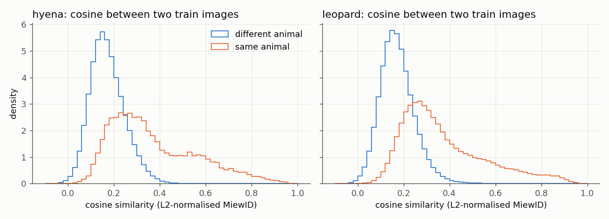
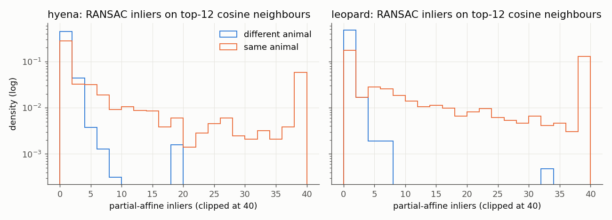
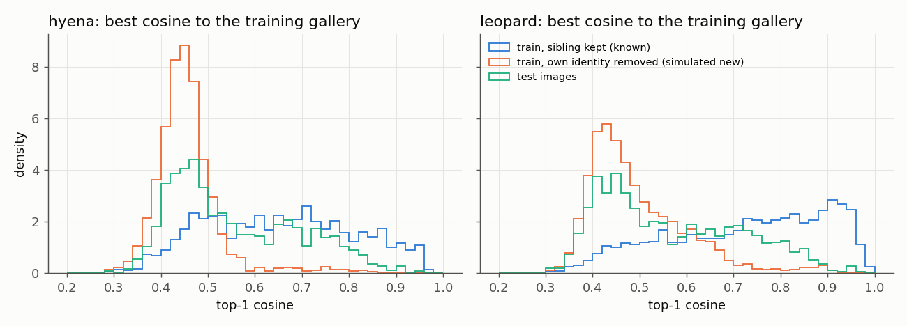

# EDA report: Wildlife Re-ID (Gate 1, first look at the data)

All numbers come from the scripts in `eda/` (`eda1_tables.py` … `eda5_figures.py`), so every number below can be regenerated.
Run any of them with `py eda/<script>.py`.

---

## 0. Two things to know before anything else

1. **The MiewID vectors are NOT unit-length.** Norms range from 48 to 239 (median 67). The plan assumed unit norm.
   So we must L2-normalise before taking cosine, $\hat x = x/\lVert x\rVert_2$. The norm itself turns out to be a useful
   "image quality" signal (Section 3), so we keep it as a separate feature rather than throwing it away.
2. **The train images are on disk** (`data/train_images_hyena|leopard`, 7,163 JPGs, no test images). The rules say
   *"The provided features are the only representation of the images you may use"* and forbid *"computing new features
   from images"*. We have not opened or used them. The question is logged in `reports/questions_for_TA.md`.

---

## 1. Integrity (all checks passed)

| Check | Result |
|---|---|
| Shapes | train 7,163 × 4, test 2,791 × 3, MiewID 9,954 × 2,152 float32 |
| Duplicate ids | none in any file |
| Alignment | `miewid_ids.csv` = train ids then test ids, in file order; covers every id exactly once |
| NaN / inf in MiewID | 0 |
| Missing viewpoint | 136 train + 42 test, **all leopards** |
| SIFT files | every id has `_xy` (float32) and `_desc` (uint8 × 128); xy within [2.3, 509.2] px |
| Identity ↔ species | `HYE*` always hyena, `LEO*` always leopard; no identity in both |
| Exact duplicate embeddings | 1 pair: `tr_00889` = `tr_05895`, same identity (LEO0032), harmless |
| Possible label noise | 1 pair of *different* identities with cosine 0.961: `tr_04352` (LEO0341) vs `tr_05221` (LEO0057). Worth remembering, not acting on. |
| Do ids encode order? | P(consecutive train rows share identity) = 0.018 vs 0.016 if shuffled, so ids look random as stated. |
| Species from embedding | logistic regression, 5-fold accuracy 0.998 (sanity check only; species is given anyway) |

---

## 2. Who is in the data

| | Hyena | Leopard |
|---|---|---|
| Train images | 1,912 | 5,251 |
| Test images | 1,217 | 1,574 |
| **Test / train ratio** | **0.64** | **0.30** |
| Train identities | 205 | 345 |
| Images per identity: median (max) | 6 (73) | 3 (391) |
| Identities with 1 image | 3 | 99 |
| Identities with 2 images | 6 | 51 |
| Identities with > 20 images | 19 (hold 36% of images) | 43 (hold **78%** of images) |

**How to read it.**
- Hyenas are "medium-shot": almost every identity has 3–20 images.
- Leopards are extremely long-tailed: 150 identities have only 1–2 images, while 43 identities hold 4,073 of 5,251 images.
  One leopard (LEO0639) has 391 images.
- Hyena test is large relative to train (0.64 vs 0.30). That hints at a larger share of new hyenas in test, but it is only a hint.

**Consequence for modelling.** A per-identity classifier would be dominated by the few huge leopard identities and would
have 1–2 samples for the rest. Retrieval (nearest neighbours) treats every identity equally, so it is the right base.
When we score an identity by its *best* image, identities with 391 images get 391 chances to look similar. That is why
the plan adds gallery-size features.

### Viewpoints

- Hyena uses all 10 labels, but `left` and `right` are 81% of images. Leopard uses only `left, right, front, back, down`
  (no diagonal labels), plus NaN.
- Train and test viewpoint mixes are similar, so there is no shift to worry about.
- Most multi-image identities have **both** a left and a right image (hyena 186/202, leopard 180/246).

---

## 3. How well does MiewID separate individuals?

**Cosine similarity** between two L2-normalised vectors is $s(a,b)=\hat a^\top \hat b \in [-1,1]$: 1 means identical
direction, 0 means unrelated.

| Percentiles of cosine | 5% | 25% | 50% | 75% | 95% |
|---|---|---|---|---|---|
| Hyena, same animal | 0.14 | 0.23 | **0.33** | 0.50 | 0.74 |
| Hyena, different animal | 0.06 | 0.12 | **0.17** | 0.22 | 0.31 |
| Leopard, same animal | 0.16 | 0.24 | **0.32** | 0.47 | 0.75 |
| Leopard, different animal | 0.06 | 0.12 | **0.17** | 0.22 | 0.31 |

**Pair AUC** is the probability that a random same-animal pair has a higher cosine than a random different-animal pair.
0.5 is a coin flip; 1.0 is perfect. Raw MiewID gives **0.857 (hyena)** and **0.874 (leopard)**.

**Interpretation.** The two distributions overlap heavily. A typical same-animal pair (0.33) is only a little above the
95th percentile of different-animal pairs (0.31). MiewID is useful but far from decisive.

**Leave-one-out (LOO) top-1 accuracy:** remove one train image, find its nearest neighbour among the other train images
of that species, and check whether it is the same identity (only for images whose identity has at least one other image).
Raw cosine gives **85.2% (hyena) / 86.3% (leopard)**. That looks good, but see Section 4: it is inflated by near-copies.

### Normalisation choice (pair AUC / LOO top-1)

| Variant | Hyena AUC | Leopard AUC | Hyena top-1 | Leopard top-1 |
|---|---|---|---|---|
| raw → L2 | 0.857 | 0.874 | 0.852 | 0.863 |
| centre (all data) → L2 | 0.866 | 0.883 | 0.850 | 0.867 |
| **standardise each dim → L2** | **0.870** | **0.885** | 0.852 | 0.868 |
| PCA-whitening d=512 | 0.764 | 0.663 | see note | see note |

The differences are small (about 1 AUC point). PCA-whitening *lowers* pair AUC a lot, but *raises* cross-encounter top-1
by 2–4 points (Section 4). The two measure different things: AUC rewards one global threshold, top-1 rewards the
ordering inside each query. This must be decided on the real CV, not here.

### The embedding norm is a quality signal

Nearest-neighbour correctness by norm quartile (lowest → highest): hyena 78% → 82% → 89% → 92%; leopard 83% → 82% → 83% → 91%.
Images with large norms are easier to match. Keep `log(norm)` as a query-level feature for the reranker and the P(new) model.

---

## 4. The most important finding: bursts, and the test set is encounter-disjoint

Camera traps take bursts of near-identical frames. Two frames from the same burst have very high cosine. Two photos of the
same animal on different days usually do not.

**Evidence the test was split by encounter, not by random image:**

| | Hyena | Leopard |
|---|---|---|
| Train–train pairs with cosine > 0.97 | 1 | 39 |
| Test images with a train image at cosine > 0.97 | **0** | **2** |
| Test images whose nearest neighbour (train ∪ test pool) is another *test* image | **55%** | **51%** |

If test were a random sample of images, many test frames would have a burst twin in train. Almost none do. Instead, test
images find their twins *inside test*. So whole encounters were moved to test.

**Cross-encounter LOO.** Same LOO experiment, but we also hide every same-identity image with cosine > c (a proxy for
"same burst"):

| Same-identity images with cosine above c removed | none | c = 0.8 | c = 0.6 | c = 0.5 |
|---|---|---|---|---|
| Hyena top-1 | 85.2% | 83.1% | **71.8%** | 43.4% |
| Leopard top-1 | 86.3% | 81.9% | **62.0%** | 38.2% |

**Consequences.**
1. A random image-level validation split would be badly optimistic. Our CV must move whole encounters.
   The plan's near-duplicate threshold (cosine distance 0.10, i.e. cosine > 0.9) is too tight. Within-identity clustering
   suggests encounters are better captured at a cosine distance of about 0.4–0.5 (2–3 images per cluster).
   We will tune it so that the CV queries' top-1 cosine distribution matches the test's (KS distance).
2. Test images of the same animal sit together. That is exactly what the plan's test-graph module exploits.

---

## 5. Viewpoint (flank) asymmetry

Mean same-animal cosine by viewpoint pair (different-animal mean in brackets):

| Pair | Hyena | Leopard |
|---|---|---|
| left–left | 0.54 (0.21) | 0.54 (0.18) |
| right–right | 0.52 (0.21) | 0.58 (0.20) |
| **left–right** | **0.28** (0.15) | **0.34** (0.16) |
| front–left / front–right | 0.24 / 0.25 | 0.31 / 0.30 |
| back–left / back–right | 0.26 / 0.25 | 0.39 / 0.38 |

The same animal seen from the opposite flank is only about as similar as the 90th percentile of different animals.
A query showing the left flank, of an animal whose gallery has only right-flank photos, will look "new". The plan's
viewpoint-compatibility features are needed. Full table: `eda/vp_compat.csv`.

---

## 6. SIFT keypoints

| | Hyena train / test | Leopard train / test |
|---|---|---|
| Median keypoints | 500 / 500 | 500 / 500 |
| Images with 0 keypoints | 1.9% / 1.8% | 0.5% / 0.8% |
| Images with < 50 keypoints | **10.9% / 10.1%** | 2.0% / 3.4% |
| Images with < 500 keypoints | 33% / 35% | 12% / 14% |

Hyena cut-outs have weaker texture: three times more images are nearly empty.

### Pilot: does SIFT + RANSAC add anything to cosine?

**Setup.** For 250 random train queries per species, take the 12 nearest images by cosine (3,000 pairs per species).
On each pair we compute RootSIFT descriptors, then Lowe ratio test at 0.8, keeping only mutual matches. We then fit a
partial-affine model (rotation, scale, translation) with RANSAC, threshold 2% of image size. The **inliers** are the
matches consistent with one transform.
Cost: about 7 ms per pair wall-clock on 10 cores, so the plan's ~300k-pair cache is about 35 minutes.

**AUC on these shortlisted pairs.** Logistic regression on cosine plus log-inliers, with out-of-fold predictions:

| Regime | Hyena: cosine → cosine+SIFT | Leopard: cosine → cosine+SIFT |
|---|---|---|
| all shortlisted pairs | 0.904 → 0.912 | 0.898 → **0.931** |
| hard zone, cosine < 0.6 | 0.816 → 0.829 | 0.822 → **0.859** |

**Better way to read it: SIFT is a high-precision, low-recall "confirmation" signal.**

| Rule: affine inliers ≥ 6 | Fires on | Precision P(same \| fires) | Recall of true matches | Recall in hard zone |
|---|---|---|---|---|
| Hyena | 15% of pairs | 97.7% | 31% | 14% |
| Leopard | 36% of pairs | 99.5% | 56% | **37%** |

*Precision* = of the pairs where SIFT fires, the fraction that are really the same animal.
*Recall* = of all same-animal pairs, the fraction where SIFT fires.

When SIFT finds 6 or more geometrically consistent matches, it is almost never wrong. When it finds none, that says
little, because most true pairs also get 0 (different flank, blur, small cut-out). So SIFT can confidently promote a
candidate but should almost never demote one. That is why AUC (which averages over all pairs) understates its value.
**It matters a lot more for leopards (rosettes) than hyenas**, matching Cheema & Anand 2017.

---

## 7. How many test images are new individuals? (π, the novelty rate)

The **top-1 cosine** of an image is its similarity to the single most similar training image of its species.
- Blue: train images with their siblings still in the gallery (a "known" animal).
- Orange: train images with their *own identity removed* (a simulated "new" animal).
- Green: the real test images, a mixture of the two.

Two estimates of π (the share of test images that are new):

| Method | Hyena | Leopard |
|---|---|---|
| A. Fit the green histogram as $w\cdot$orange $+ (1-w)\cdot$blue (non-negative least squares) | 0.38 | 0.63 |
| B. 2-component Gaussian mixture on the green values; weight of the low component | 0.60 | 0.52 |

**These disagree by 10–20 points, so neither should be trusted yet.** Both have a known bias. The blue "known" curve
contains burst twins, which test does not have (Section 4). Real known test images are therefore *less* similar than blue,
which pushes both methods to overestimate π. The honest summary is: **somewhere around 35–60% of test images are probably
new individuals**, and that is a large share.

> **Update after Gates 2–5.** Three later estimates narrowed this to **π ≈ 0.30–0.34 (hyena) and 0.33–0.38 (leopard)**:
> the novelty rate of the CV split that best matches the test top-1 distribution, the mean predicted P(new) on test, and
> Saerens EM on test (gate4.md / gate5.md). As predicted above, the first two methods overestimated it.

Why it matters: P(new) decides where `new_individual` goes in every one of the 2,791 rankings.
**Recommended fix:** one leaderboard probe with the unchanged `sample_submission.csv` (everyone = `new_individual`).
Its public MAP@5 is *exactly* the share of new individuals in the public 30% (each row scores 1 if new, else 0).
That is about 837 images, so the standard error is about $\sqrt{0.5\cdot0.5/837}\approx 0.017$.
It does not give per-species values, but it pins down the overall level.

---

## 8. What this changes in the plan

| Plan assumption | What the data says | Change |
|---|---|---|
| MiewID vectors are unit-norm | norms 48–239 | L2-normalise; keep log-norm as a feature |
| near-duplicate threshold 0.10 cosine distance | test is encounter-disjoint; encounters are looser | group encounters at about 0.4–0.5, tune by KS vs test |
| SIFT ~2–5 ms/pair | ~7 ms/pair wall on 10 cores, still fine | keep K = 60 cache (≈35 min) |
| SIFT helps both species | strong for leopard, weak for hyena | per-species models/thresholds (already in plan); expect gains mostly on leopard |
| π̂ from a GMM | GMM and histogram mixture disagree | use the LB probe as the anchor; re-estimate inside CV |
| PCA whitening as an obvious win | mixed: hurts AUC, helps top-1 | test only on proper CV |

## 9. Viva questions on this EDA

1. **Why is LOO top-1 = 86% misleading?** Most nearest neighbours are burst twins from the same encounter. Test images
   have no burst twins in train. Removing same-identity neighbours with cosine > 0.6 drops it to 62–72%.
2. **How do you know test is encounter-disjoint?** Train has 39 leopard pairs above 0.97 cosine. Test has only 2 images
   with such a twin in train, but over half of test images have their nearest neighbour inside test.
3. **SIFT's AUC is only 0.6–0.8; why use it?** AUC averages over all pairs. SIFT almost never fires on different animals
   (precision ≥ 97%), so when it fires it is decisive. It just rarely fires. It is a confirmation signal, strongest on leopards.
4. **Why can't you just trust your novelty estimate?** Two reasonable methods disagree (0.38 vs 0.60 for hyena), and both
   are biased upward by burst twins in the "known" reference. One all-`new_individual` leaderboard probe measures it directly.
