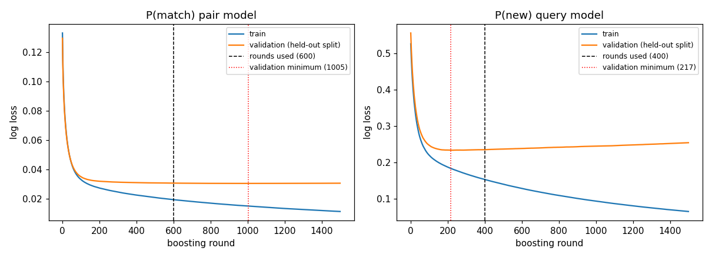

# Wildlife Re-Identification (Problem 3): report notes, team BLACKbox

Final submission: `submissions/sub_20261121-160242_sub_team_blend_lnb3.csv` (Kaggle name `sub_team_blend_lnb3.csv`), public LB **0.86515** (rank 2 at the time of writing).
Second selected submission: `sub_team_blend_lnb2.csv` (0.86164).

## 1. Task and metric
For each of the 2,791 test images (hyena 1,217, leopard 1,574), rank up to 5 labels: a training identity of the same
species or `new_individual`. MAP@5. Ranking labels by probability is MAP@5-optimal, and 5 guesses are always output.

## 2. Validation (the most important design choice)
No validation set is given, so we simulate the test:
- "Encounters" = connected components (cosine > 0.8) of images within an identity (near-duplicate shots).
- Hold out 10 % of identities entirely (their images become `new_individual` queries), hold out ~40 % of the encounters
  of the remaining identities, and keep **one query image per encounter**.
- Why: the first design kept held-out encounters together, so queries had near-duplicate siblings. It gave CV 0.91 vs
  public 0.80. Adversarial validation (AUC 0.83) showed test images rarely have such siblings. The final design matches
  the test on both query->gallery and query->query similarity profiles.
- **Leak-free protocol**: overlapping splits put the same image in several query sets; training rows whose query image is
  a query in the evaluated split are dropped (the leak was worth ~0.005).
- Result: honest CV is ~0.01 above public LB and **ranks methods in the same order**.

## 3. Pipeline (two independent pipelines, blended)
**Dev's pipeline** (`dev_pipeline/wildlife_reid_solution.ipynb`):
1. Embeddings fitted on the gallery only: centred + L2 MiewID cosine; PCA(256) -> LDA (shrinkage 0.3) projection.
2. Identity score = max cosine over the identity's images; top-20 candidate identities.
3. SIFT verification of the provided keypoints: RootSIFT, 2-NN + Lowe ratio 0.8, one-to-one, RANSAC homography and
   similarity inliers (top-5 identities x 20 images, ranks 6-10 x 2 images).
4. **LNBNN one-vs-many keypoint matching (HotSpotter, Crall et al. 2013)**: each query descriptor is matched against all
   training descriptors of its species (faiss-cpu); identity score = sum of (background distance - distance) over the K=10
   nearest neighbours. Gallery masking keeps CV honest.
5. Viewpoint (left/right flank) features; query-query kNN graph features (transductive, no labels).
6. Two-round LightGBM: P(match | query, identity) + P(new | query); round 2 adds neighbours' round-1 predictions.
   LambdaRank re-ranker blended 50/50. Temperature-calibrated label probabilities (T fitted by NLL on honest CV).

**Sabari's pipeline** (`src/reid`, config `configs/exp_v8_mix_lnb.json`): raw / PCA-whitened / LDA cosine retrieval (top-30),
wide SIFT verification (15 identities x 8 images), LightGBM reranker + P(new) + softmax temperature, trained on two split
designs, query-query pair model + label propagation (Zhou et al. 2004) over the test graph, plus the same LNBNN features.
**Keypoint query graph**: the propagation graph also links each test image to the 5 other test images sharing the most
SIFT keypoints (LNBNN-style votes, faiss-cpu), not only its 10 MiewID neighbours; the pair model decides which links to
trust. On leopards ~25 % of these new links are the same animal (links MiewID misses).

**Blend**: 50/50 average of the two pipelines' calibrated label probabilities (simple model combination). The two pipelines
pick a different top-1 label on ~11 % of test images, so the average fixes errors of each.

## 4. Results (MAP@5)
| Version | Validation | Public LB |
|---|---|---|
| Dev v5 (MiewID + LDA + SIFT + 2-round LightGBM) | 0.8532 | 0.84102 |
| Sabari v8 | 0.9133 (his CV design) | 0.84856 |
| 50/50 blend | 0.8658 (shared CV) | 0.85813 |
| Dev + LNBNN, blended with v8 | 0.8675 (shared CV) | 0.86073 |
| both + LNBNN, blended | v8: 0.9131 -> 0.9145 | 0.86164 |
| **+ keypoint query graph in v8, blended (FINAL)** | v8: 0.9145 -> 0.9176 (5/5 splits) | **0.86515** |

LNBNN alone: known-animal top-1 0.48 (MiewID 0.74), but correct where MiewID is wrong for 5.3 % of known queries; adding it
as features improved Dev's model on all 8 splits (round-1 A/B 0.8473 -> 0.8518).

**Tried and dropped** (no gain on honest CV or lower public LB): PCA-whitening and BoVW (Dev), centroid / logistic identity
scores, query expansion / database-side augmentation, wide SIFT search for missed identities (~5 % recoverable), blend
weight tuning (+0.0017 CV, -0.001 LB), stacking meta-model (+0.0013 CV), propagation of the blend (+0.0020 CV, 0.85464 LB),
prior-shift of P(new) (0.85504), LNBNN normalisation / candidate expansion / LNBNN-guided RANSAC (<= +0.002 expected),
self-training with pseudo-labelled test images (+0.0025 CV, 0.85829 LB: the test has more new animals, ~31 % vs 22 %, so
confident pseudo-labels are wrong more often).

Remaining loss (shared CV, blend): known animal ranked below `new_individual` 0.058, true identity not among candidates
0.035 (often only the opposite flank is in the gallery), wrong identity first 0.027, new animal not first 0.013.

## 5. Overfitting check
- **Model level** (train vs held-out-split log loss of Dev's LightGBM models, 3 held-out splits; ):
  P(match) validation loss is flat from ~400 to 1,500 rounds; at the 600 rounds used it is within 0.0002 of its minimum.
  P(new) validation loss is lowest at ~220 rounds and rises slowly after; at the 400 rounds used it is 0.0015 above the
  minimum, but cutting to 250 rounds does not improve MAP@5 (0.8513 vs 0.8518, better on only 2/8 splits), so ranking is
  unaffected. Sabari's models use early stopping on grouped out-of-fold data.
- **Leaderboard level**: every kept change was decided on honest validation first and improved most splits (LNBNN 8/8,
  keypoint graph 5/5); the public LB then moved the same way (0.85813 -> 0.86073 -> 0.86164 -> 0.86515). Changes that only
  looked good on validation by a small margin and lost on the LB were dropped, not tuned further on the public score.
  Validation (~0.866 shared CV) and public LB (0.865) agree, so there is no sign of fitting the public 30 %. The private
  score can still differ by roughly +-0.01 from sampling alone (about 1,950 private vs 840 public images).

## 6. Rule compliance
| Rule | How it is met |
|---|---|
| Only provided features (MiewID, SIFT keypoints, species, viewpoint) | the `train_images_*` folders are never read; no keypoints are detected |
| No new features from images, no pretrained models | RootSIFT, PCA, LDA, cosine and LNBNN scores are transforms of the given descriptors |
| Allowed models | PCA, LDA projection, kNN / distance retrieval, SIFT ratio test + RANSAC, LightGBM, label propagation (graph), simple model combination |
| Allowed libraries | numpy, pandas, scipy, scikit-learn, lightgbm, opencv (matching / RANSAC only), faiss-cpu, networkx |
| No DL frameworks / AutoML / LLM predictions / hand-labelling | none used; every prediction comes from the code |
| No sharing between teams | code shared only inside the team |

## 7. Likely viva questions (short answers)
- *Why not tune on the public LB?* ~840 public images: differences under ~0.002 are noise; the honest CV ranked methods
  correctly, while LB-driven tweaks (prior shift, self-training) went the wrong way.
- *Why does LNBNN help when it is weaker than MiewID?* It uses local spot patterns and makes different mistakes; LightGBM
  learns when to trust it (it is right for 5 % of known animals where MiewID's top-1 is wrong).
- *Why blend two pipelines?* They disagree on 11 % of top-1 labels; averaging calibrated probabilities beat both
  (+0.0096 LB over the better one).
- *Is the test-graph use fair?* It uses only test features, never test labels (transductive inference); the rules forbid
  labels and external data, not unsupervised use of the given test features.
- *Biggest remaining error?* Known animals seen in a new encounter (low similarity, no keypoint match) get
  `new_individual` ranked first; with only the provided features there is little evidence left to fix them.
