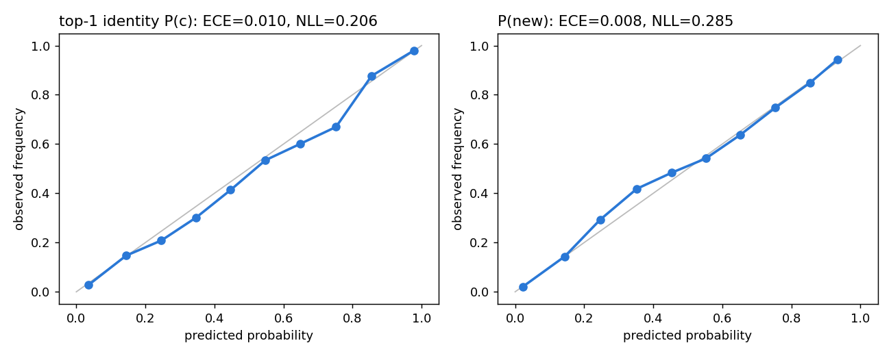

# Gate 4: SIFT verification, learned reranker, P(new), decision rule (Stages B, C, D)

## What was built
- `src/reid/sift_match.py`: RootSIFT, then nearest neighbours by one matrix product (RootSIFT vectors are unit-length, so
  $\lVert a-b\rVert^2 = 2-2a^\top b$), Lowe ratio test (0.8) in both directions, mutual matches only. Then
  `cv2.estimateAffinePartial2D` (RANSAC, threshold 2% of image size) and `cv2.findHomography`. 14 pair features.
  Unit-tested on synthetic data (a known similarity transform gives > 80% inliers; random points give < 8;
  0 keypoints give NaN, not 0).
- `src/reid/sift_cache.py`: label-free pair cache, filled in parallel (10 processes). **455k pairs in 20 minutes
  (2.7 ms/pair).** Which pairs are used is decided per fold: for each query, its top-10 identities (raw and whitened
  cosine) × the 3 most similar gallery images of each, chosen with that fold's gallery labels only.
- `src/reid/candidates.py`: one row per (query, candidate identity); 20 candidates per query (union of the top
  ranks under raw / whitened / LDA). 61 features. Groups: global, SIFT, viewpoint, gallery stats, query quality,
  reciprocity.
- `src/reid/models.py`: LightGBM reranker (monotone +1 on cosines and inliers), out-of-fold by query identity.
- `src/reid/calibration.py`: temperature $T$, P(new) model, prior-shift EM, $\beta$ offset.
- `src/reid/pipeline.py` + `scripts/02_run_cv.py` / `03_make_submission.py`: the same code path for CV and test.

## How a prediction is made (Stage D)
1. Reranker → $p_c$ = P(candidate $c$ is the true identity) for each of the 20 candidates.
2. Known-identity posterior: $P(c\mid x,\text{known})=\mathrm{softmax}_c(\mathrm{logit}(p_c)/T)$. $T$ minimises NLL on
   out-of-fold data ($T\approx1.3$ for both species).
3. Novelty model: $\pi(x)=P(\text{new}\mid x)$ from query-level features (best/second reranker score, logit gap,
   top-1 cosines, SIFT best inliers, side coverage, query quality).
4. $P(c\mid x)=(1-\pi')\,P(c\mid x,\text{known})$, $P(\text{new})=\pi'$, where $\pi'=\sigma(\mathrm{logit}\,\pi+\beta_{sp})$.
5. **Output the 5 labels with the highest probability.** Expected AP $=\sum_k P(\ell_k)/k$ has decreasing weights,
   so any out-of-order pair can be swapped for a gain (exchange argument). `tests/test_metric.py` checks this
   over all 120 orderings of the plan's worked example.

## Why "out-of-fold by query identity" (a change from the plan's leave-one-split-out)
The 5 CV splits overlap: the same train image is a query in several splits. Leave-one-split-out would train on an image
and test on the same image. Instead, all rows of all splits are pooled and split with `GroupKFold` on the query's true
identity. A model never sees, as a training query, any image of the animal it is evaluated on.

## Results (paired on the same 5 splits)
| Experiment | CV MAP@5 | Hyena | Leopard | Δ vs parent (SE) | Decision |
|---|---|---|---|---|---|
| Gate 3 reranker, no SIFT | 0.8784 ± 0.010 | 0.859 | 0.894 | — | — |
| **+ SIFT features** | **0.8947 ± 0.011** | 0.865 | **0.918** | **+0.016 (0.0015)** | **accept** |
| + viewpoint imputer for 178 missing viewpoints | 0.8939 | 0.864 | 0.917 | −0.001 (0.0005) | reject |

Known-query MAP: hyena 0.826, leopard 0.890. P(new) ROC-AUC: hyena 0.908, leopard 0.954.
"softmax" and "direct" combination rules are equivalent (0.8943 vs 0.8947).

### Drop-one-group ablation (retrain without the group; Δ vs full model)
| Group removed | # feats | Δ CV MAP@5 (SE) | Reading |
|---|---|---|---|
| SIFT | 18 | **−0.0131 (0.0008)** | the biggest single contributor; leopard −0.018, hyena −0.007 |
| viewpoint / side | 6 | −0.0036 (0.0012) | flank-aware evidence matters |
| whitened cosine | 10 | −0.0026 (0.0008) | |
| LDA cosine | 10 | −0.0023 (0.0010) | partly redundant with whitening |
| query quality (norm, #kp) | 2 | −0.0009 (0.0007) | small |
| reciprocity rank | 1 | −0.0003 (0.0005) | no measurable value |
| gallery size, #viewpoints | 2 | +0.0004 (0.0005) | no measurable value |

### Calibration (out-of-fold)

| Quantity | ECE | NLL | mean predicted | observed rate |
|---|---|---|---|---|
| top-1 identity probability | 0.010 | 0.206 | 0.570 | 0.564 |
| P(new) | 0.008 | 0.285 | 0.358 | 0.361 |

**ECE** (expected calibration error) $=\sum_b \frac{n_b}{N}\,|\bar p_b-\bar y_b|$ over 10 probability bins: the average gap
between "predicted 70%" and "actually right 70% of the time". 0.01 means within about one percentage point. This matters
because the sort-by-probability rule is only optimal if the probabilities are honest.

### Novelty rate on test (three independent estimates)
| | KS-matched CV (Gate 2) | mean P(new) on test | Saerens EM on test |
|---|---|---|---|
| Hyena | 0.30 (ridge 0.15–0.30) | 0.30 | 0.27 |
| Leopard | 0.38 (ridge 0.34–0.43) | 0.36 | 0.35 |

They agree within about 5 points. Prior-shift correction is therefore left **off** (it would move P(new) by at most a few percent).

Submission: `submissions/sub_20261119-063601_sub_g4_rerank_sift.csv` (`new_individual` at rank 1 for 41% of test images).

## What surprised us
- On hyenas SIFT adds only +0.007, on leopards +0.018. Rosettes are distinctive and textured; hyena cut-outs have 3× more
  near-empty keypoint sets (EDA §6). This matches Cheema & Anand 2017 (SIFT wins on jaguar spots).
- The probabilities came out well calibrated without any extra calibration step. Log-loss training + softmax temperature
  is enough, and the tuned $\beta$ offsets are near 0 (−0.15 to +0.5), a sign the P(new) model is not biased.

## Viva questions
1. *Why does the reranker have one row per (query, identity) and not per (query, image)?* The label we output is an
   identity. Aggregating per identity (best image, SIFT over the 3 best images, side coverage) lets the model reason
   about the animal as a whole, e.g. "high cosine but no same-side image".
2. *What do monotone constraints do?* They force the model's output to be non-decreasing in cosine and inlier
   count. With only ~2,600 queries per split, a free GBDT can learn noisy reversals ("more inliers → less likely") in
   sparse regions. The constraint encodes physics we are sure of.
3. *If π̂ on test were 0.5 instead of 0.35, what would you do?* Apply the prior-shift formula
   $\pi'=\frac{\rho_1\pi}{\rho_1\pi+\rho_0(1-\pi)}$ with $\rho_1=\pi_{test}/\pi_{cv}$, $\rho_0=(1-\pi_{test})/(1-\pi_{cv})$.
   It is implemented (`calibration.prior_shift`, switched on by `calibration.prior_shift: true`), but not needed
   because the estimates agree.
